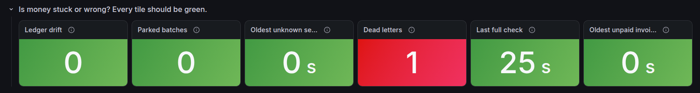
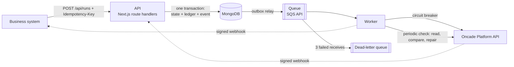

# Payout runs on the Oncade Platform API

Take-home exercise for Oncade, by Wesley Oliveira. Unofficial: this is not an Oncade product.

## What I built

A TypeScript service that takes two flows of the guides end to end on the test API, with webhooks: it bills a client with one **invoice** and, when the invoice is paid, pays a team through **payouts**.

On 2026-11-17 one run went the whole way in test: invoice issued and paid, three people paid, run `completed`. The service learned of the invoice payment from a signed webhook, and of the payout by reading the API. The record is in [docs/test-api-run.md](docs/test-api-run.md).

**How I would know that something is wrong, and how I would find one payment.** Each run is followed by its reference. From it, `npm run where` prints the timeline of the run and the links to its trace and its logs in Grafana. The trace is one tree: it starts at the webhook, crosses the queue and shows each payout. Nine alert rules watch for money that is stuck or wrong, and five of them are proven by a drill that causes the failure and reads the alert firing. The tools are OpenTelemetry and Grafana, and [docs/observability.md](docs/observability.md) shows all of it in five pictures. This is one of them: the first row of the dashboard, half a minute after a message failed on purpose.



A service that moves money has to know what the API does when a request is repeated, when a call arrives in the wrong state and when a webhook does not come. So I asked: the same five questions to every family of the API, 72 of the 75 endpoints in the reference. What it answered is the next section.



## What I found

**[feedback/part-2-platform-api.md](feedback/part-2-platform-api.md)**: 28 items, tagged broken, feels broken or confusing. Each says where it happened, what I did, what I expected and what happened, and names its source. The five I would look at first:

| #   | Finding                                                                                                                                                                                                                       | Tag          |
| --- | ----------------------------------------------------------------------------------------------------------------------------------------------------------------------------------------------------------------------------- | ------------ |
| 1   | [A repeated `Idempotency-Key` creates a duplicate](feedback/part-2-platform-api.md#1-a-repeated-idempotency-key-creates-a-duplicate-on-five-kinds-of-create) on invoices, payouts, recurring invoices, campaigns and API keys | broken       |
| 2   | [Starting or stopping a test campaign answers 500](feedback/part-2-platform-api.md#2-starting-or-stopping-a-test-campaign-answers-500)                                                                                        | broken       |
| 3   | [No event tells a platform that a payout paid from the dashboard is done](feedback/part-2-platform-api.md#3-no-event-tells-a-platform-that-a-payout-paid-from-the-dashboard-is-done)                                          | confusing    |
| 4   | [In test, money comes from a public faucet, and nothing says so](feedback/part-2-platform-api.md#4-in-test-money-comes-from-a-public-faucet-and-nothing-says-so)                                                              | confusing    |
| 5   | [A payout accepts a total that does not match its recipients, and changes it silently](feedback/part-2-platform-api.md#5-a-payout-accepts-a-total-that-does-not-match-its-recipients-and-changes-it-silently)                 | feels broken |

One more, because it is about funds: [a funded, running campaign can be deleted, and its funds do not come back](feedback/part-2-platform-api.md#6-a-funded-running-campaign-can-be-deleted-and-its-funds-do-not-come-back) (item 6).

**[feedback/part-1-oncade-pay.md](feedback/part-1-oncade-pay.md)**: 12 items from using the Pay app in Brazil, in Portuguese, with a Pix account. It opens with where Part 1 stands. The two I would look at first: [with test mode off, the dashboard still lists my test invoices and payouts](feedback/part-1-oncade-pay.md#1-with-test-mode-off-the-dashboard-still-lists-my-test-invoices-and-payouts) (broken), and [I could not find where to submit a support ticket](feedback/part-1-oncade-pay.md#2-i-could-not-find-where-to-submit-a-support-ticket) (feels broken).

**How the Part 2 items were found, and where the proof is.**

- **Five questions per family:** does the happy path work, what does a bad request answer, does a repeated key make a duplicate, what does a call in the wrong state answer, which webhooks arrive. One script per family in [explore/](explore/); what each call answered is in [explore/results/](explore/results/), and endpoint by endpoint in [docs/api-coverage.md](docs/api-coverage.md).
- **Recorded replies:** real replies and real webhook deliveries, with ids and addresses scrubbed, are in [tests/contract/fixtures/](tests/contract/fixtures/). The contract tests read them: when the replies are recorded again and a behaviour has changed, a test fails and says where to look.
- **The docs** were read as raw text on 2026-11-17, and each screen quoted has a screenshot in [feedback/screenshots/](feedback/screenshots/).

**What the API does, and what the service does about it.**

| What the API does                                                         | What the service does                                                                                                                               | Where                                                                                            |
| ------------------------------------------------------------------------- | --------------------------------------------------------------------------------------------------------------------------------------------------- | ------------------------------------------------------------------------------------------------ |
| A repeated key creates a second invoice or payout                         | A create is sent once. After a lost answer the service looks for the object by its own reference: one found, adopted; none or two, a person decides | [client.ts](lib/oncade/client.ts), [send-batch.ts](lib/flows/send-batch.ts)                      |
| No event for a payout paid from the dashboard; any webhook can be missing | A webhook only says when to look. A periodic check reads the API and calls the same function                                                        | [webhook.ts](lib/flows/webhook.ts), [fund.ts](lib/flows/fund.ts), [sweep.ts](lib/flows/sweep.ts) |
| A delivery carries no id                                                  | A repeated delivery is recognised by a hash of its raw body                                                                                         | [lib/core/webhook.ts](lib/core/webhook.ts)                                                       |
| A cancelled payout still shows its recipients as pending                  | The payout's status is the answer: its people are free again, unless a line shows as paid                                                           | [reconcile.ts](lib/core/reconcile.ts)                                                            |
| One address can be in a payout three times, and a line has no id          | A payroll with a repeated address is refused before anything is sent                                                                                | [create-run.ts](lib/flows/create-run.ts)                                                         |

## How to run it

Node 24 and Docker. (Node runs the TypeScript files directly, which needs 22.18 or newer.) No credentials are needed: a local stand-in answers in place of Oncade.

```sh
npm ci
docker compose up -d --wait      # MongoDB, the queue, Grafana on 127.0.0.1:3301
npm run stand-in                 # terminal 1: the local imitation of Oncade
npm run build && npm run start   # terminal 2: the API on 127.0.0.1:3300
npm run worker                   # terminal 3
npm run demo                     # 300 people, 15 payouts
```

Then `npm run where -- <reference>` prints the timeline of the run. `npm run drill` causes five failures on purpose (stop the worker first: it runs its own). `npm run check` runs types, lint, format, 109 unit and contract tests and the context budget; `npm run test:flows` runs 44 flow tests against a real MongoDB and a real queue.

### Against the Oncade test API, with webhooks

1. Copy `.env.example` to `.env`. Fill in a platform **test** key, a token and two addresses you read. A live key is refused before any call.
2. `npm run check-api -- probe` reads the key, the scopes and the grant, and finds the business. `npm run check-api -- link` asks for the scopes that are missing.
3. Open a tunnel to port 3300, for example `ngrok http 127.0.0.1:3300`. Copy its address in full.
4. In the developer portal, in your platform's Settings, set the webhook URL to `<tunnel address>/api/webhooks/oncade` and generate the secret. Put it in `.env` as `ONCADE_WEBHOOK_SECRET`.
5. Stop the API and the worker, and start them pointed at Oncade. A script whose name ends in `:oncade` talks to the test API; the same script without it talks to the stand-in.

   ```sh
   npm run start:oncade                # terminal 2
   npm run worker:oncade               # terminal 3
   ```

   The two never share data: Oncade runs have their own database and queue. A script refuses to run when it is not pointed at what the API and the worker are pointed at.

6. Then:

   ```sh
   npm run real-run:oncade             # invoice and payout created, funding simulated, both cancelled
   npm run real-run:oncade -- --pay    # nothing simulated: you pay both at the provider, the run ends completed
   npm run where:oncade -- <reference> # the timeline of that run
   npm run explore -- invoices         # one family of the API: the five questions
   ```

The test balance is USDC on Base Sepolia, a public test network. A public faucet fills it.

### What ran against what

|                                                                        | Local stand-in                  | Oncade test API                                     |
| ---------------------------------------------------------------------- | ------------------------------- | --------------------------------------------------- |
| A run of three people, funding simulated, then cancelled               | Yes                             | Yes                                                 |
| The same run paid for real: invoice paid, payout paid, run `completed` | Yes                             | Yes, 2026-11-17, from a test balance                |
| Webhooks: signed, verified, a repeat recognised                        | Yes                             | Yes: 16 kinds of event received, 8 kept as fixtures |
| Every call of the reference                                            |                                 | 72 of 75 called, 65 with a success                  |
| A run of 300 people, end to end                                        | Yes: `npm run demo`             |                                                     |
| Five failure drills: a lost answer, an outage, a lost webhook          | Yes, 30 checks: `npm run drill` |                                                     |

The stand-in ([stand-in/server.ts](stand-in/server.ts)) imitates the calls this project makes, and follows the recorded replies. It exists because the real API will not lose a webhook or drop an answer on request. The queue is ElasticMQ, which speaks the SQS API: this project has not run on AWS.

## How I used AI

**Which tools.** Claude Code, Anthropic's coding agent, in VS Code. It read the API reference as raw text, wrote most of the code, the tests and these documents, ran the checks and called the test API. I gave the design and the rules, made the decisions, and did what needs a person: the portal, the payments, the reading.

**How it started.** Before any code, I gave the agent a list: the good practices for the design of a system that moves money, and the common mistake behind each one. A request that is repeated. Two workers on the same work. A timeout taken for a failure. A webhook that never comes, or comes twice, or is forged. A cancel taken for a fact. Books that drift from their entries. Then I asked for each mistake to be tested on purpose, and I said what to test and what to look for:

- **In this service:** a test or a drill that causes the mistake, and a check of what the system does then. Those are the twelve rows of [docs/design.md](docs/design.md).
- **In Oncade's API:** the same five questions for every family of calls. Does the happy path work? What does a bad request answer? Does a repeated `Idempotency-Key` make a duplicate? What does a call in the wrong state answer? Which webhooks arrive? Each answer decides a part of the design of a service built on that API.

I chose what to look for. The agent did the looking, and it recorded every answer.

**The setup, which is in this repository.**

- [AGENTS.md](AGENTS.md): the one page an agent always loads. Money rules, hard limits, commands.
- [TESTING.md](TESTING.md): what is tested, what is not, and why. `lib/core` must be fully covered; nothing else has a target.
- [docs/context/](docs/context/): pages an agent reads only when the task needs them. One is the API contract, with each fact marked as seen or from the docs.
- `npm run context:budget` measures those files and fails the build when one grows past its limit.
- [.claude/settings.json](.claude/settings.json): the agent may not read `.env`, commit or push.

**Where it saved time.**

- Reading the whole reference and asking every family of the API the same five questions: 72 endpoints, each answer recorded.
- Turning real replies into scrubbed fixtures, and writing the tests that read them.
- The observability set-up: traces across the queue, metrics, alert rules, a dashboard, and drills that read them.

**Where it got things wrong.** [docs/ai-log.md](docs/ai-log.md) lists twenty errors of the agent, each with the check that caught it, and seven proposals I changed. Four of the errors:

| What the agent did                                                                       | What caught it                                                       |
| ---------------------------------------------------------------------------------------- | -------------------------------------------------------------------- |
| Built the stand-in so that a repeated `Idempotency-Key` returned the first reply         | The real API, which made a second invoice                            |
| Trusted a tool's summary of a docs page, which described a discrepancy that is not there | Reading the page as raw text, which is a rule of the setup           |
| Gave a latency histogram, measured in seconds, buckets meant for milliseconds            | The dashboard: every p95 read "5 s". No test would have caught it    |
| Let the queue and the periodic check both create the invoice of one run                  | A failure drill. The step claims its work with one conditional write |

**A review by other agents, and a mirror.** When the code was done, nine reviewer agents read it, one specialist for each part: the money rules, the client and the webhooks, storage, the queue, the steps of a run, the routes, the tests, the scripts, the configuration. Each got the decisions I had made on purpose and one rule: a finding needs a file, a line and a concrete failure. They wrote 134 findings. None was taken on trust: each one that led to a change was first checked against the code, and the strongest were reproduced by running them. Two were races that every test had passed, because the tests ran one thing at a time: two batches ending at the same moment, and one cancel delivered twice.

Then I asked this service's own API the questions I had asked of Oncade: 70 checks. It found five failures, among them a `500` for a request it should have refused. They are fixed, and each has a flow test now; [tests/flows/api.test.ts](tests/flows/api.test.ts) asks the API's own questions. The reviewers were wrong too, and [docs/ai-log.md](docs/ai-log.md) says where.

The pattern I take from it: the agent is fast and confident. It is wrong where only reality answers, and where two things happen at the same moment. So the rules send it to reality early: a real call before a design, a recorded reply before a claim, a drill before "it works", and a reviewer that did not write the code.

## Where things are

| Folder                                                     | What is in it                                                                                                                                                                                                                                                            |
| ---------------------------------------------------------- | ------------------------------------------------------------------------------------------------------------------------------------------------------------------------------------------------------------------------------------------------------------------------ |
| [feedback/](feedback/)                                     | The findings, with screenshots                                                                                                                                                                                                                                           |
| [app/](app/), [worker/](worker/)                           | The API routes, and the worker with its three loops: outbox relay, queue consumer, periodic check                                                                                                                                                                        |
| [lib/core/](lib/core/)                                     | The money rules, with no I/O: states, ledger, idempotency, webhook signature, reconciliation                                                                                                                                                                             |
| [lib/flows/](lib/flows/)                                   | One file per step of a run: create, invoice, fund, send, confirm, cancel                                                                                                                                                                                                 |
| [lib/oncade/](lib/oncade/)                                 | The client of the Platform API                                                                                                                                                                                                                                           |
| [lib/infra/](lib/infra/), [lib/telemetry/](lib/telemetry/) | MongoDB with transactions, and the queue; traces, metrics and logs                                                                                                                                                                                                       |
| [explore/](explore/)                                       | The five questions, one script per family of the API, and the answers                                                                                                                                                                                                    |
| [stand-in/](stand-in/), [scripts/](scripts/)               | The local imitation of Oncade; the demo, the drills and the run against the test API                                                                                                                                                                                     |
| [tests/](tests/)                                           | Unit tests of the rules, contract tests on recorded replies, flow tests on a real database                                                                                                                                                                               |
| [docs/](docs/)                                             | [Design](docs/design.md): twelve failures and what the code does about each. [The API of this service](docs/api.md). [What ran on the test API](docs/test-api-run.md). [Observability](docs/observability.md) and a [runbook](docs/runbook.md). [AI log](docs/ai-log.md) |
| [observability/](observability/)                           | Nine alert rules and a Grafana dashboard, loaded by `docker compose`                                                                                                                                                                                                     |

## What is missing on purpose

- **The partner payout path,** where the platform sends the funds on chain itself. Here the business owner pays from the Oncade dashboard.
- **Refunds.** I found no refund call in the reference. After a confirmed cancel the ledger shows the amount as owed back to the client, for a person to send.
- **A deployment.** On Vercel the worker's three loops would be a cron route and queue-triggered functions. The code in `lib/flows` would not change.
