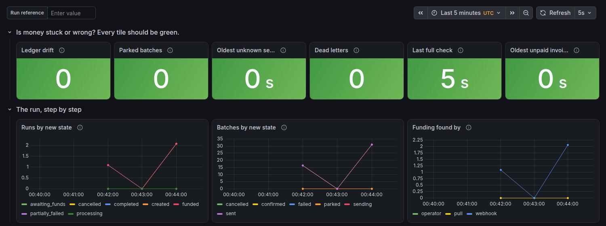
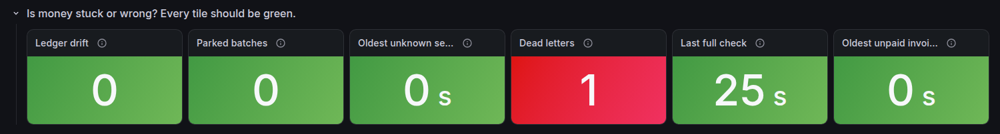
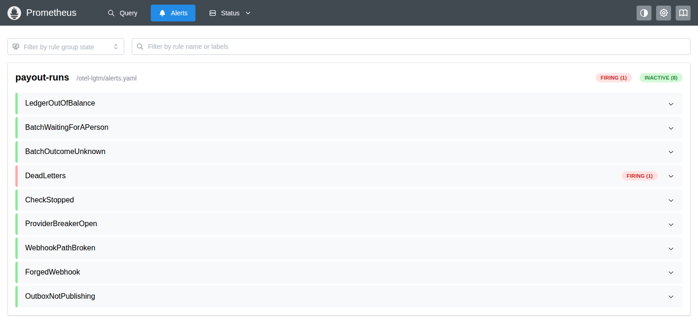
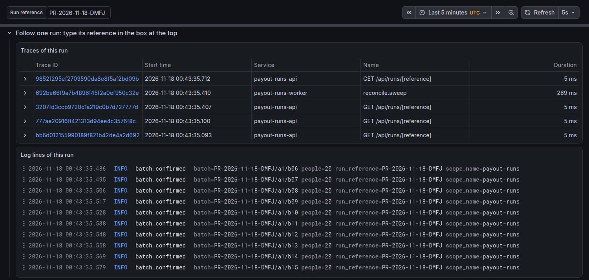
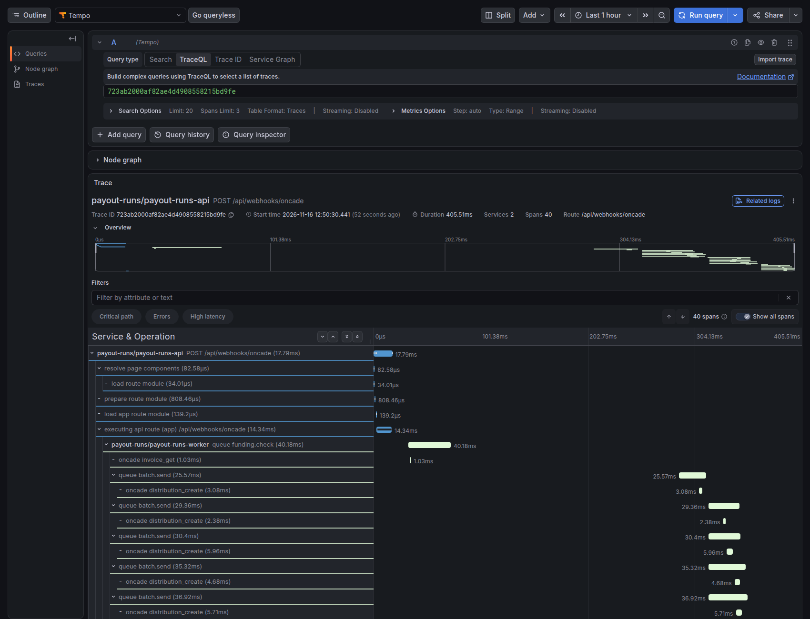

# Observability

This page answers three questions that a person on call asks: is something wrong, what is it, and where is this customer's payment. An agent reads it before adding a metric, a span, a log line or an alert.

## In five pictures

Each picture says what it shows and why it is there. The first four are from one local session against the stand-in; the fifth is from an earlier run.

### 1. Is money stuck or wrong? No

- **What it shows:** the dashboard after three runs of 300 people each. The first row has six tiles and all are green: the books balance, no batch waits for a person, no send has an unknown result, no message is dead, the periodic check ran 5 seconds ago, no invoice waits for payment. The second row shows the runs and their batches moving through their states, and that each payment was found by its webhook.
- **Why:** it answers the first question of anyone on call in one look. A tile is a number that should be zero, so nobody has to read a graph to know.
- **See it yourself:** `npm run demo`, then open `http://127.0.0.1:3301`.

### 2. Something is wrong

- **What it shows:** the same row, half a minute after I put on the queue a message that can never succeed. The worker tried it three times, the queue moved it to the dead-letter queue, and the tile turned red.
- **Why:** the failure shows without anyone reading logs, and the other five tiles say that the rest of the work is fine.

### 3. The alert fires

- **What it shows:** Prometheus evaluates the nine alert rules of this project every five seconds. Eight are inactive and `DeadLetters` is firing.
- **Why:** nobody watches a dashboard all day. Each rule carries a severity, page or ticket, and the section of the [runbook](runbook.md) to open. For this one the runbook says: `npm run operator -- dead-letters` shows the message, and `redrive` sends it again after the fix.
- **See it yourself:** `npm run drill -- 5` causes this failure, reads the alert going from `inactive` to `firing`, and clears it.

### 4. Where is this customer's payment?

- **What it shows:** the reference of a run typed in the box at the top, and the last row of the dashboard: the traces of that run and its log lines. Every line carries `run_reference`.
- **Why:** a customer asks about a payment by their own reference, not by a trace id. From the reference a person reaches every trace and every log line of the run. `npm run where -- <reference>` prints the timeline of the run and links to the same traces and logs.

### 5. One payment, from the webhook to the payouts

- **What it shows:** one trace of a run. It starts in the API, at the webhook that says an invoice was paid. It goes on in the worker, which reads the invoice and then sends each batch to the provider.
- **Why:** the two processes only talk through a queue. The trace context travels with each message, so the path of a payment is one tree, and the step that is slow or failing shows at once.

## Three signals, one reference

| Signal  | Answers                                                                           | Here       |
| ------- | --------------------------------------------------------------------------------- | ---------- |
| Metrics | Is something wrong, and how much? Cheap, always on, good for alerts               | Prometheus |
| Traces  | Where in the path did this one request go wrong, and how long did each step take? | Tempo      |
| Logs    | What exactly happened at that step?                                               | Loki       |

All three leave the processes through OpenTelemetry (OTLP over HTTP). The backend is whatever answers at `OTEL_EXPORTER_OTLP_ENDPOINT`: here the `grafana/otel-lgtm` container.

What ties them together is the **run reference**:

- every span of a run has the attribute `run.reference`;
- every log line has `run_reference`, plus the `trace_id` of the span it was written in;
- every state change stored in the database keeps the trace id that caused it.

So from a customer's reference you reach the traces, from a trace its log lines, and from a row in the database the trace that wrote it. `npm run where -- <reference>` prints the links.

**The trace crosses the queue.** The trace context is saved with each outbox event and travels as a message attribute, so the worker's span continues the trace of the request that caused it. A run of 300 people shows as one tree with 15 batches. That is picture 5.

**A reference is never a metric label.** Labels hold small fixed sets (a state, an outcome, an operation). Ids belong in traces and logs: as labels they would create one time series per run.

**Nothing personal is logged.** No e-mail, no wallet, no key: ids only.

## Metrics, and the question each one answers

| Metric                                                | Question                                          | Alert                    |
| ----------------------------------------------------- | ------------------------------------------------- | ------------------------ |
| `ledger_drift_accounts`                               | Do the books still balance?                       | `LedgerOutOfBalance`     |
| `batches_parked`                                      | Is a batch waiting for a person?                  | `BatchWaitingForAPerson` |
| `batches_oldest_sending_age_seconds`                  | Is there a send whose result nobody knows?        | `BatchOutcomeUnknown`    |
| `queue_messages{state}`                               | Is work piling up? Is anything dead-lettered?     | `DeadLetters`            |
| `reconcile_last_success_seconds`                      | Is the safety net itself running?                 | `CheckStopped`           |
| `breaker_state`                                       | Did the provider stop answering?                  | `ProviderBreakerOpen`    |
| `funding_recorded_total{path}`                        | Is the webhook path alive? `pull` means it is not | `WebhookPathBroken`      |
| `webhooks_received_total{outcome}`                    | Accepted, repeated, forged?                       | `ForgedWebhook`          |
| `webhooks_handle_duration_seconds`                    | Do we answer inside the provider's 10 seconds?    | dashboard                |
| `oncade_request_duration_seconds{operation, outcome}` | Which call is slow or failing?                    | dashboard                |
| `outbox_unpublished`                                  | Are events reaching the queue?                    | `OutboxNotPublishing`    |
| `runs_oldest_unfunded_age_seconds`                    | How long has a client not paid?                   | dashboard                |
| `runs_transitions_total`, `batches_transitions_total` | How much work, ending how?                        | dashboard                |
| `reconcile_differences_total{kind, repair}`           | What did the check find, and who repairs it?      | dashboard                |
| `notifications_sent_total{outcome}`                   | Does our customer hear about its runs?            | dashboard                |

Two details that cost me a wrong reading before I fixed them:

- A histogram in seconds needs buckets in seconds. The SDK's defaults are for milliseconds, so every call landed in the first bucket and each p95 read as five seconds.
- A counter that is born at 1 shows no growth. Every counter is set to zero for each label value when a process starts, and the zeros are sent before any work.

## Alerts: who is woken, and for what

An alert pages when money may be wrong or stuck and a person can act. Everything else is a ticket.

| Alert                    | Fires when                         | Severity | Threshold in the demo | Where I would start in production |
| ------------------------ | ---------------------------------- | -------- | --------------------- | --------------------------------- |
| `LedgerOutOfBalance`     | a balance differs from its entries | page     | any                   | any                               |
| `BatchWaitingForAPerson` | a batch is parked                  | page     | any                   | any                               |
| `BatchOutcomeUnknown`    | a batch is `sending` too long      | page     | 60 s                  | three times the lease             |
| `DeadLetters`            | a message failed three times       | page     | any                   | any                               |
| `CheckStopped`           | no complete check, or no worker    | page     | 30 s                  | three times the interval          |
| `ProviderBreakerOpen`    | the breaker is open                | ticket   | at once               | page after 15 minutes             |
| `WebhookPathBroken`      | the pull found a payment           | ticket   | any in 2 min          | more than a few per hour          |
| `ForgedWebhook`          | a signature did not match          | ticket   | any in 2 min          | any in 10 minutes                 |
| `OutboxNotPublishing`    | events are not published           | ticket   | 100 for 1 min         | by the usual backlog              |

The rules are in [`observability/alerts.yaml`](../observability/alerts.yaml) and Prometheus evaluates them. `npm run drill` causes five failures and reads the state of the alert behind each one: a drill passes only if the alert was `inactive` before and `firing` after. Five of the nine rules are proven that way: `CheckStopped`, `ProviderBreakerOpen`, `WebhookPathBroken`, `ForgedWebhook` and `DeadLetters`. Prometheus evaluates the other four too, and no drill makes them fire. What to do when one fires is in [runbook.md](runbook.md).

## What I would change for production

- **Sampling.** Every trace is kept here. In production I would keep all traces with an error or a state change of money, and sample the rest.
- **Objectives.** Two service-level objectives to start: time from "client paid" to "every batch sent", and the share of runs that end without a person.
- **Where metrics come from.** On Vercel a function does not live long enough to push metrics on a timer. The gauges would be emitted by the scheduled check, as they already are here.
- **Retention and access.** Logs of payments are kept longer than debug logs, and reading them is restricted.
